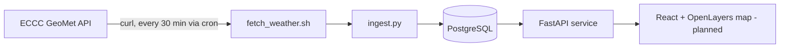
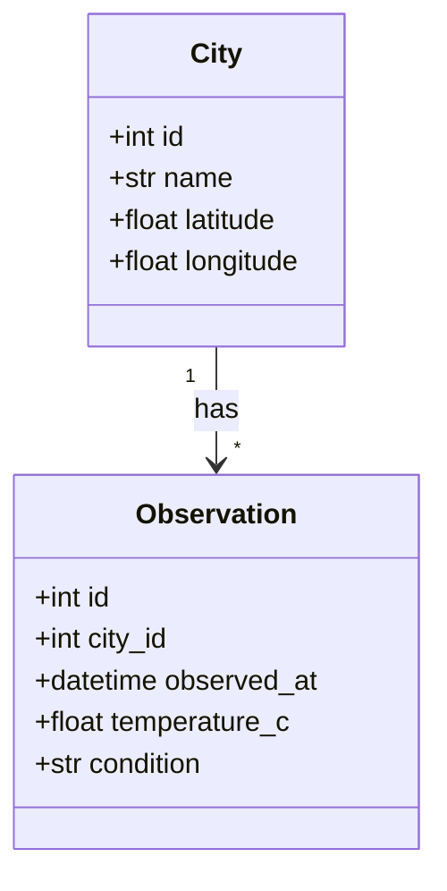

# Architecture

## Data flow

## Data model

## Design notes

- `scripts/ingest.py` separates parsing (`parse_items`) from storage (`save`), so the API format can change without touching the database code.
- Observations are de-duplicated on `(city_id, observed_at)`, so re-running the fetch is safe.
- Tests run against SQLite so CI does not need a PostgreSQL service.
